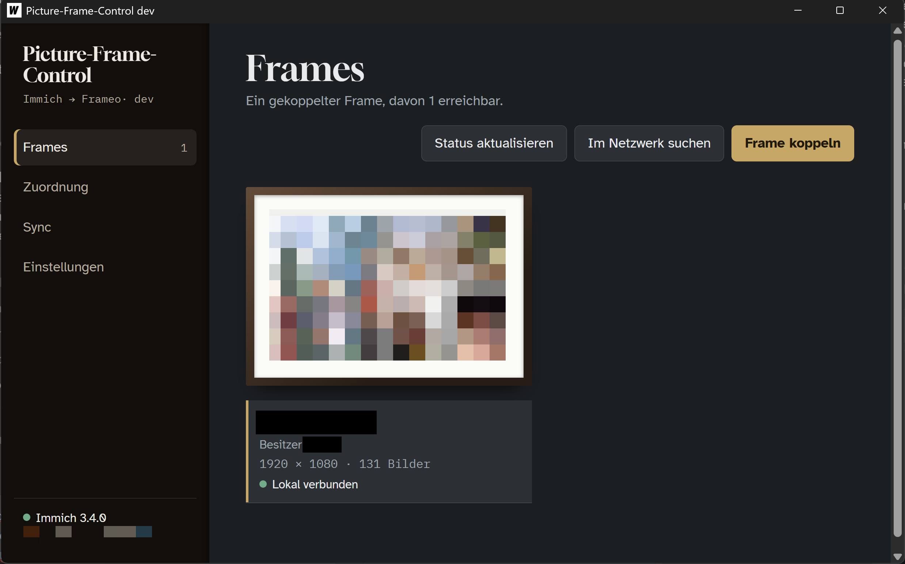
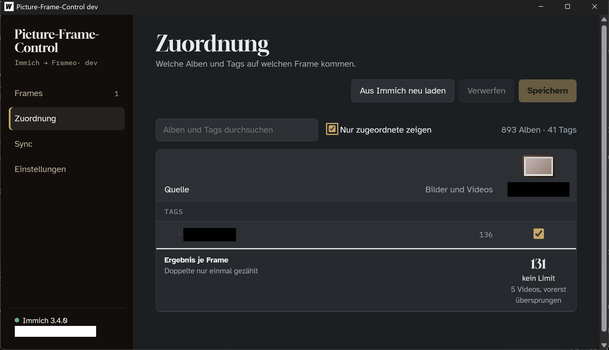

# Picture-Frame-Control

[](https://github.com/dhcgn/picture-frame-control/actions/workflows/ci.yml)
[](https://github.com/dhcgn/picture-frame-control/releases/latest)

A Windows app that manages Frameo digital photo frames and mirrors albums and tags from [Immich](https://immich.app) onto one or more of them.

- Pair frames, browse them, hide, show, delete, download and send photos
- Assign Immich albums and tags to frames (many to many), with a preview of what a sync will change
- Sync: send new photos, remove the ones no longer selected, and touch photos the app did not send only when you say so
- Optionally use the album name as the photo caption
- Optionally shrink photos to the frame's resolution as WebP with [ImageMagick](https://imagemagick.org)
- Optionally send videos too, converted with [ffmpeg](https://ffmpeg.org) to what Frameo plays (H.264, up to the frame's resolution, 30 fps, up to 4:59)

The user interface is in English and German; by default it follows the Windows display language.

<p>
  
  
</p>

## Installation

1. Download the latest `picture-frame-control_<version>_windows_amd64.exe` from [Releases](https://github.com/dhcgn/picture-frame-control/releases/latest) and run it. There is no installer.
2. Under **Settings**, enter your Immich address and API key. The key needs read access to albums, tags and assets.
3. Under **Frames**, pair a frame with the code shown on its display, or take over existing pairings from [unframeo](https://github.com/borje/unframeo).
4. Optional: install [ImageMagick](https://imagemagick.org/script/download.php#windows) and/or [ffmpeg](https://ffmpeg.org/download.html#build-windows) and click **Find** under **Settings → Preparing photos and videos**. With ImageMagick, photos go to the frames shrunk to their screen as WebP. With ffmpeg, videos go too; without it they are skipped.

Settings are stored in `%APPDATA%\picture-frame-control`. The API key and the pairing key are encrypted there for your Windows user (DPAPI).

## Updates

On start, the app asks GitHub whether a newer version exists. If one does, the sidebar offers the update. Only a click downloads it, verifies it against `SHA256SUMS`, replaces the program and restarts it. Pre-releases (`v1.2.0-rc.1`) are never offered.

## Development

Requirements: Go 1.27, Node 22, `wails3` v3.1.0 (`go install github.com/wailsapp/wails/v3/cmd/wails3@v3.1.0`).

```powershell
wails3 dev      # run the app with hot reload
wails3 build    # bin\picture-frame-control.exe, version "dev"
go test ./...   # tests; frame, grid and Immich run as fakes
```

Live tests against a real frame paired with unframeo: `go test -tags live ./internal/frameo`

HTML mockups of the screens (German): [mockups](mockups/index.html)

## Releasing

Pushing a `v*` tag runs [`release.yml`](.github/workflows/release.yml): it builds with the tag as version and publishes a release with the executable and `SHA256SUMS`.

```powershell
git tag v1.0.0
git push origin v1.0.0
```

A tag with a suffix (`v1.1.0-rc.1`) is published as a pre-release.

### AI-written release notes (optional)

If the repository secret `COPILOT_PAT` is set, GitHub Copilot writes the release notes from the commits since the previous release ([`actions/ai-inference`](https://github.com/actions/ai-inference)). Without the secret, or if that step fails, the release gets GitHub's generated notes.

Setup:

1. A GitHub account with Copilot access.
2. A [fine-grained personal access token](https://github.com/settings/personal-access-tokens/new) with the account permission **Copilot Requests** (read-only).
3. Store it as the secret `COPILOT_PAT` under *Settings → Secrets and variables → Actions* in this repository.

## License

GPL-3.0-or-later. The Frameo protocol implementation comes from [unframeo](https://github.com/borje/unframeo); see [NOTICE](NOTICE). Frameo is a trademark of Frameo ApS, Immich is a project of FUTO. This project is affiliated with neither.
