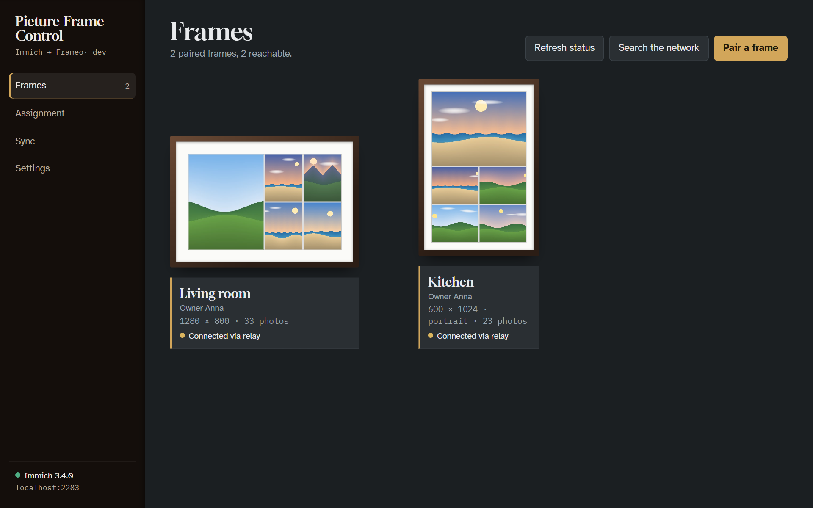
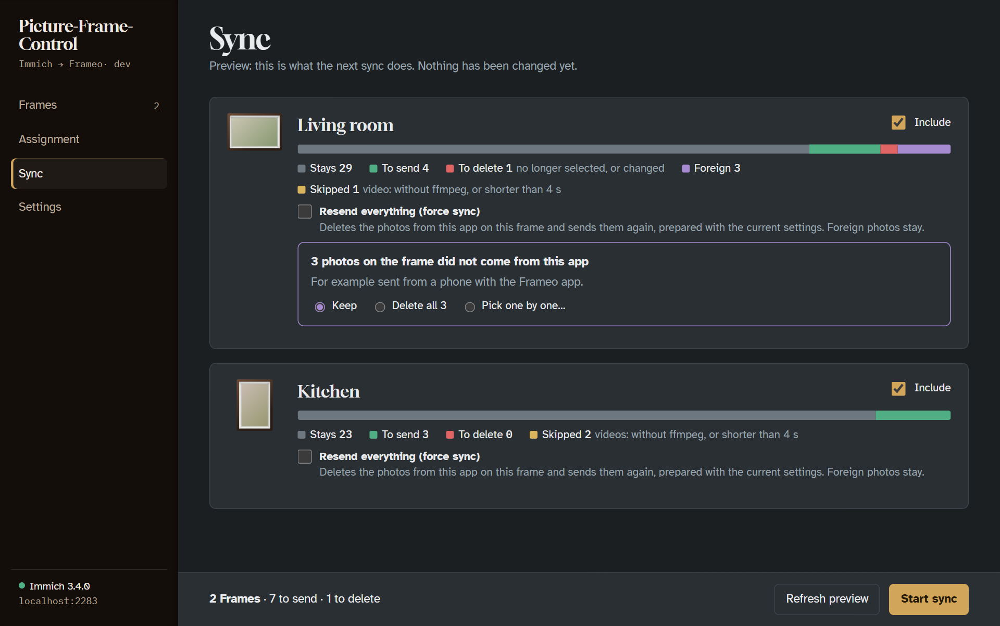
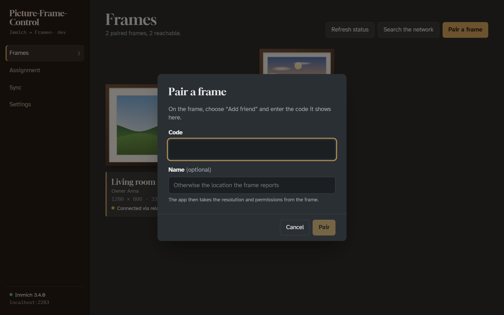
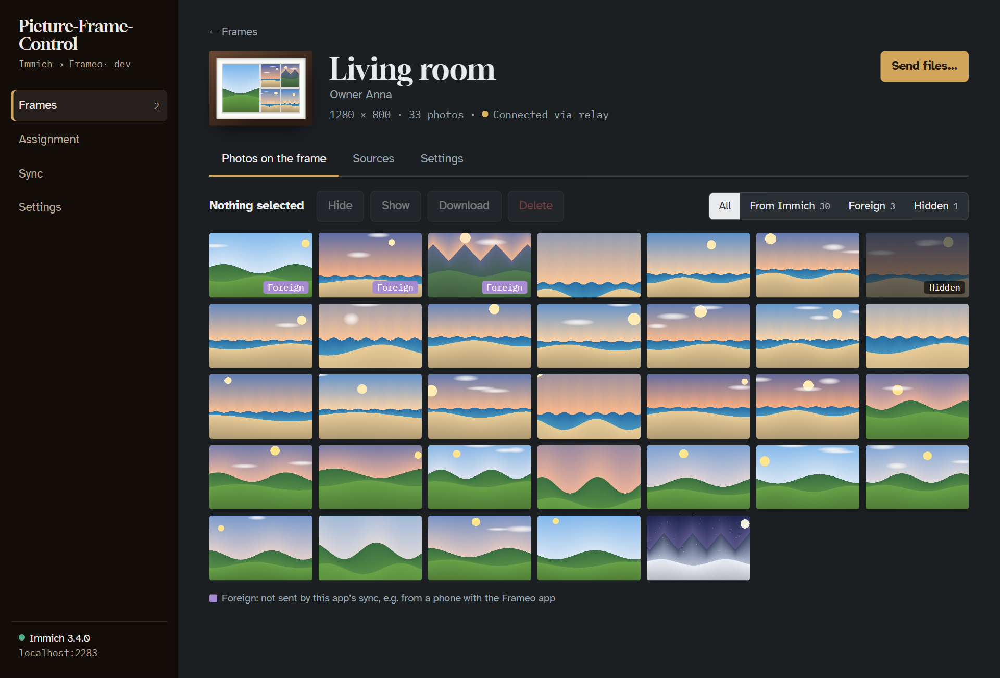
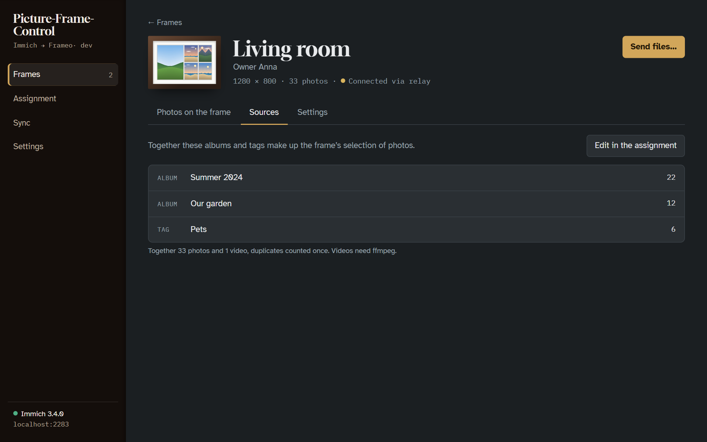
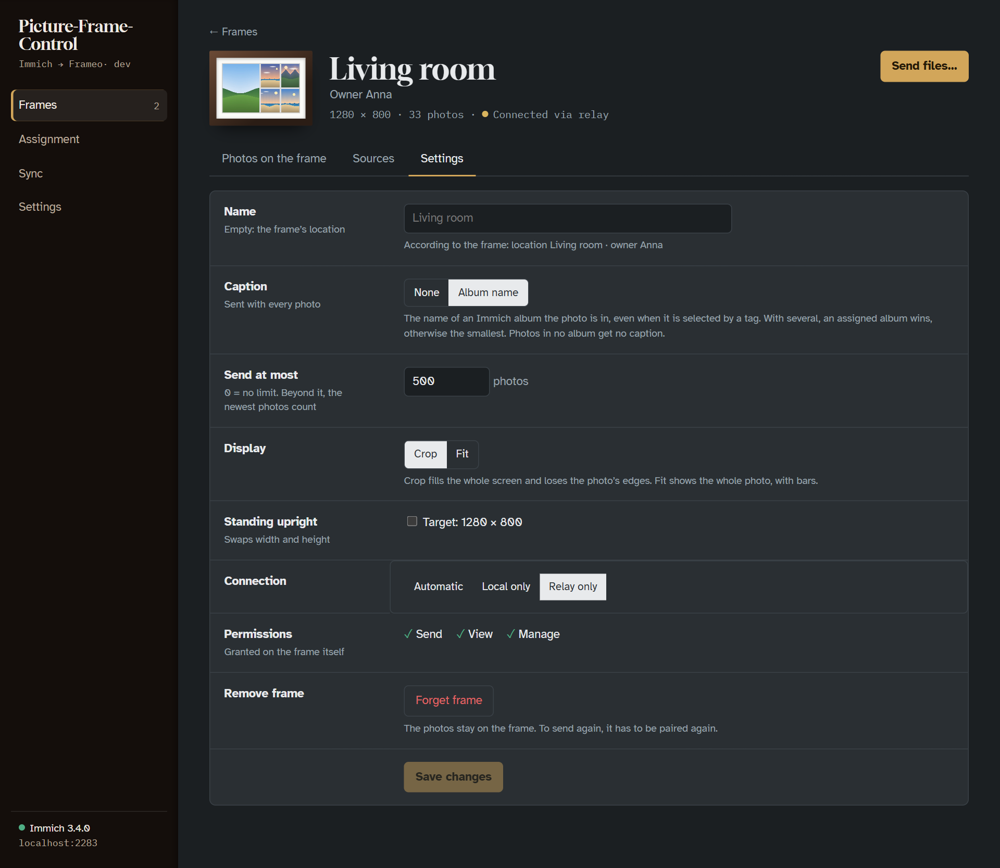
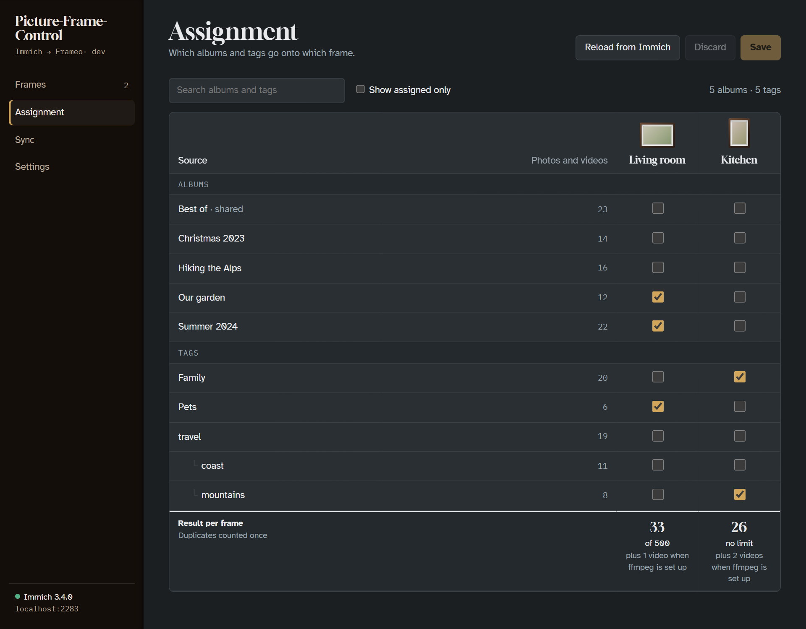
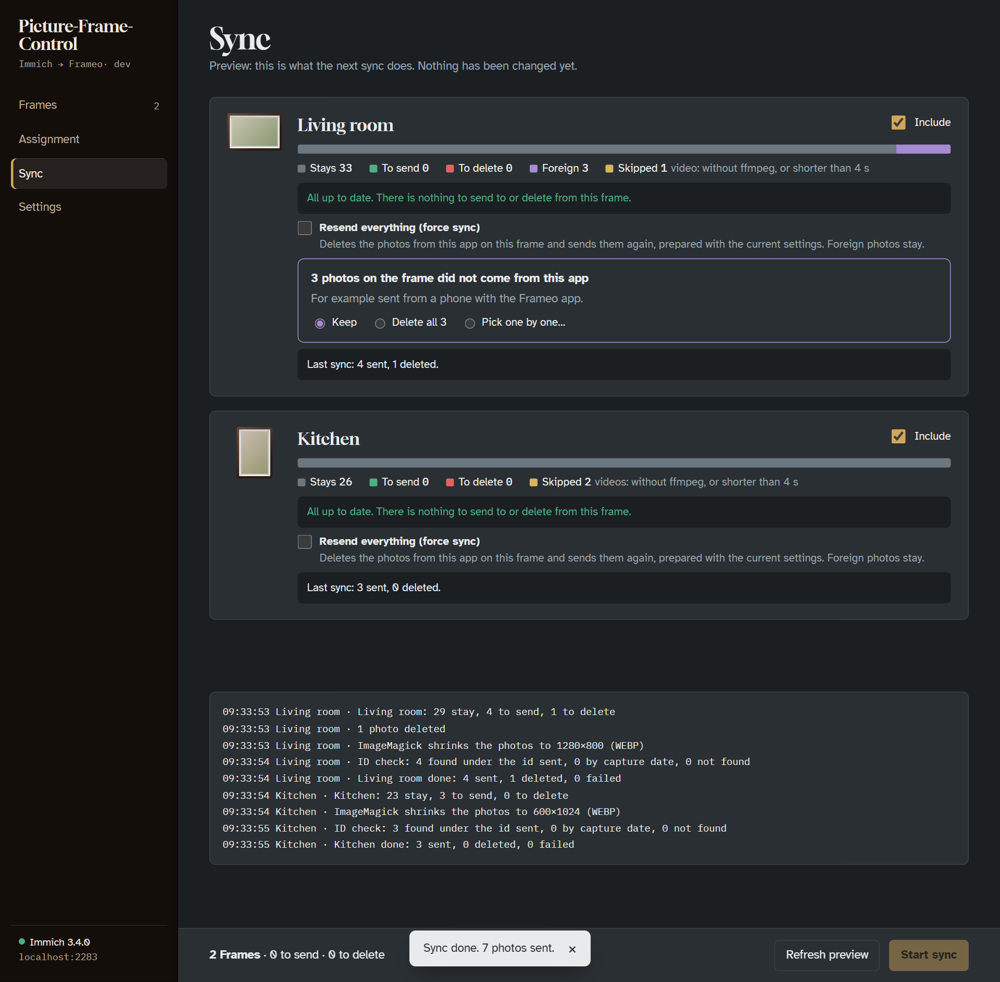
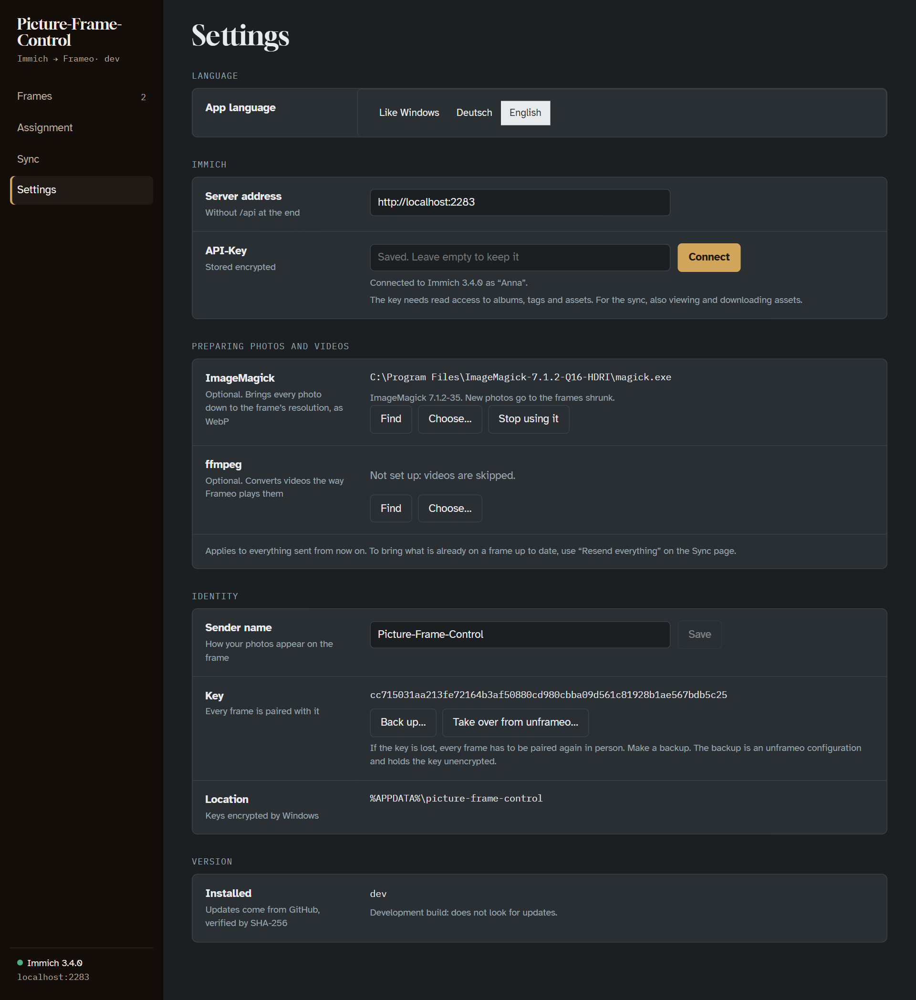

# Picture-Frame-Control

[](https://github.com/dhcgn/picture-frame-control/actions/workflows/ci.yml)
[](https://github.com/dhcgn/picture-frame-control/releases/latest)

**A Windows desktop app that syncs photos and videos to Frameo digital picture frames.**

Pick any number of [Immich](https://immich.app) albums and tags for each frame, and the app keeps the frame in step with them. Local folders as a source are planned ([#1](https://github.com/dhcgn/picture-frame-control/issues/1)).

<p>
  
  
</p>

## Why

**More photos on the same frame.** Every photo is brought to the frame's native resolution and stored in an efficient format: WebP for photos, H.264 for videos. Smaller files mean more of your photos fit on the frame. Nothing is ever enlarged, and nothing arrives below the frame's resolution if Immich has more.

**No tinkering with the frame.** Other ways to fill a Frameo frame from a computer rely on ADB, a sideloaded APK on the frame, or a command-line tool. Picture-Frame-Control is a regular desktop app. It pairs with the frame the same way the Frameo phone app does, with the code shown on the frame.

## Features

- **Sources:** multiple Immich albums and tags per frame, and the same album or tag on several frames (many to many). Parent tags include their child tags.
- **Sync with a preview:** see what will be sent, kept and deleted before anything happens. The frame mirrors its sources: new photos are sent, photos no longer selected are removed.
- **Photos sent from elsewhere** (e.g. from a phone) are only deleted if you say so, one by one or all at once.
- **Photos:** with ImageMagick, shrunk from the original to the frame's screen as WebP. Without it, Immich's preview, or the full-size image where the preview is too small.
- **Videos:** with ffmpeg, converted to what Frameo plays: H.264/AAC, up to the frame's resolution, 30 fps, under 125 MB, cut at 4:59. Without ffmpeg they are skipped.
- **Captions:** optionally the name of the Immich album a photo is in, plus the year it was taken unless the name already has one, and the people Immich assigned to the photo with their age on the day: `Ostsee 2021 + Danny (30), Maria (4)`. From 5 people on only initial and age.
- **Force sync:** resend everything with the current settings, e.g. after installing ImageMagick.
- **Frame management:** find frames on the network, pair, rename, browse the photos on a frame, hide, show, delete, download, and send files by hand.
- **Limits:** keep at most a number of photos per frame, newest first. A full frame stops the sync for that frame and says so.
- **Updates:** built in, from GitHub Releases.
- **Languages:** English and German, following the Windows display language by default.

## Screenshots

Made with invented frames, albums and drawn landscapes (see [Development](#development)).

<table>
  <tr>
    <td width="50%"><a href="docs/screenshots/frames.png"></a><br><b>Frames</b>: every paired frame with its recent photos and whether it is reachable.</td>
    <td width="50%"><a href="docs/screenshots/pair.png"></a><br><b>Pairing</b> with the code the frame shows under “Add friend”.</td>
  </tr>
  <tr>
    <td><a href="docs/screenshots/frame-photos.png"></a><br><b>Photos on a frame</b>: which came from Immich, which from elsewhere, which are hidden. Hide, show, delete, download.</td>
    <td><a href="docs/screenshots/frame-sources.png"></a><br><b>Sources</b> of one frame and what they add up to.</td>
  </tr>
  <tr>
    <td><a href="docs/screenshots/frame-settings.png"></a><br><b>Frame settings</b>: name, caption, limit, crop, fit or smart (fit portrait photos only), standard or compact videos (720p, about 2 Mbps, to save storage), portrait mounting, connection, permissions.</td>
    <td><a href="docs/screenshots/assignment.png"></a><br><b>Assignment</b>: albums and tags against frames, many to many, with the result per frame.</td>
  </tr>
  <tr>
    <td><a href="docs/screenshots/sync-preview.png"></a><br><b>Sync preview</b>: what stays, what is sent and deleted, photos from elsewhere, force sync.</td>
    <td><a href="docs/screenshots/sync-done.png"></a><br><b>After the sync</b>: the result per frame and the log.</td>
  </tr>
  <tr>
    <td><a href="docs/screenshots/settings.png"></a><br><b>Settings</b>: language, Immich, ImageMagick and ffmpeg, identity.</td>
    <td></td>
  </tr>
</table>

## What the app needs

To download from Immich, convert, and upload to the frame, the app needs access to both sides:

- **Immich** (version 3.2 or later): the server address and an API key (in Immich: *Account Settings → API Keys*) with read access to albums, tags and assets, and permission to view and download assets.
- **The frame:**
  - **Pairing:** with the code shown on the frame, or taken over from an existing [unframeo](https://github.com/borje/unframeo) setup.
  - **Permissions:** to list, mirror and delete photos, the app needs **view** and **manage** on the frame. It asks for them, and the frame's owner taps *Allow* on the frame.
  - **Network:** the frame is reached on the local network, or through Frameo's relay over the internet.

## Getting started

1. Download the latest `picture-frame-control_<version>_windows_amd64.exe` from [Releases](https://github.com/dhcgn/picture-frame-control/releases/latest) and run it. There is no installer.
2. Under **Settings**, enter your Immich address and API key.
3. Under **Frames**, pair a frame, then request the view and manage permissions.
4. Under **Assignment**, tick the albums and tags for each frame and save.
5. Under **Sync**, check the preview and start the sync.

Settings are stored in `%APPDATA%\picture-frame-control`. The API key and the pairing key are encrypted there for your Windows user (DPAPI).

### Optional: ImageMagick and ffmpeg

Install either or both, then click **Find** under **Settings → Preparing photos and videos**:

- [ImageMagick](https://imagemagick.org/): photos are shrunk to the frame's screen as WebP.
- [ffmpeg](https://ffmpeg.org/download.html#build-windows): videos are sent too, converted for the frame.

What Frameo itself accepts: [Supported media](https://support.frameo.com/hc/en-us/articles/12110057465106--Supported-Media).

## Updates

On start, the app asks GitHub whether a newer version exists. If one does, the sidebar offers the update. Only a click downloads it, verifies it against `SHA256SUMS`, replaces the program and restarts it. Pre-releases (`v1.2.0-rc.1`) are never offered.

## Development

Requirements: Go 1.27, Node 22, `wails3` v3.1.0 (`go install github.com/wailsapp/wails/v3/cmd/wails3@v3.1.0`).

```powershell
wails3 dev                # run the app with hot reload
wails3 build              # bin\picture-frame-control.exe, version "dev"
go test ./...             # tests; frame, grid and Immich run as fakes
wails3 task screenshots   # docs/screenshots, with made-up data
```

Tests that use ImageMagick or ffmpeg run when the tools are installed and are skipped otherwise. Live tests against a real frame paired with unframeo: `go test -tags live ./internal/frameo`

**Screenshots:** `wails3 task screenshots` builds the app in server mode and runs it with a profile of its own, against a fake Immich (five albums, five tags, drawn landscapes) and two fake frames. A headless Chrome or Edge then clicks through every view and saves it to `docs/screenshots`. Nothing of your own settings or photos is used. Run it again after changing the UI. ImageMagick, if installed, is shown as set up.

HTML mockups of the screens (German): [mockups](mockups/index.html)

## Releasing

Pushing a `v*` tag runs [`release.yml`](.github/workflows/release.yml): it builds with the tag as version and publishes a release with the executable and `SHA256SUMS`.

```powershell
git tag v1.0.0
git push origin v1.0.0
```

A tag with a suffix (`v1.1.0-rc.1`) is published as a pre-release.

### AI-written release notes (optional)

If the repository secret `COPILOT_PAT` is set, GitHub Copilot writes the release notes from the commits since the previous release ([`actions/ai-inference`](https://github.com/actions/ai-inference)). Without the secret, or if that step fails, the release gets GitHub's generated notes. Running the workflow by hand with a tag rewrites the notes of that release.

Setup:

1. A GitHub account with Copilot access.
2. A [fine-grained personal access token](https://github.com/settings/personal-access-tokens/new) with the account permission **Copilot Requests** (read-only).
3. Store it as the secret `COPILOT_PAT` under *Settings → Secrets and variables → Actions* in this repository.

## Thanks

My special thanks go to [unframeo](https://github.com/borje/unframeo/), which did the heavy lifting: it worked out the Frameo protocol and its transport, and its implementation is the base this app talks to the frames with.

## License

GPL-3.0-or-later. The Frameo protocol implementation comes from [unframeo](https://github.com/borje/unframeo); see [NOTICE](NOTICE). Frameo is a trademark of Frameo ApS, Immich is a project of FUTO. This project is affiliated with neither.
