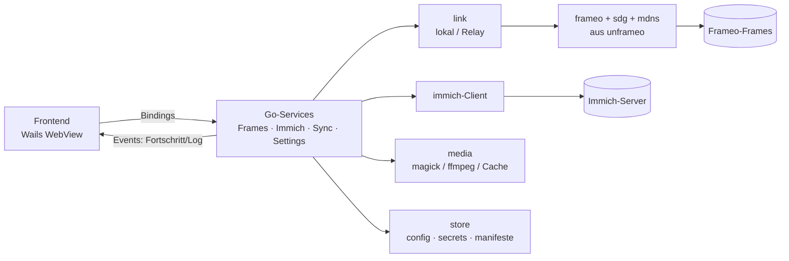

# Picture-Frame-Control – Umsetzungskonzept

Stand: 2026-11-20 · Status: Entwurf zur Abstimmung · Basis: [anforderungen.md](anforderungen.md)

## 1. Technologie

| Thema | Wahl | Begründung |
|---|---|---|
| Sprache | Go 1.27.4 | Aktuell. unframeo (1.26) und immich-admin-cli (1.27) passen |
| UI-Framework | Wails v3.1.0 | Stabiles v3-Release: Services als Go-Structs, TS-Bindings generiert, Events Go → UI |
| Frontend | Svelte + TypeScript | Wails-Template, Vite. Wenig Code für reaktive Listen, Matrix und Fortschritt |
| Persistenz | JSON-Dateien, atomar geschrieben (temp + rename) | Wenige tausend Einträge je Frame. Keine DB, kein cgo |
| Secrets | DPAPI über `golang.org/x/sys/windows` | Bereits Abhängigkeit von unframeo, keine neue Lib |
| Immich-Client | Handgeschrieben (`net/http` + `encoding/json`) | 6 Endpunkte. Der generierte Client hätte 59.000 Zeilen |
| Lizenz | GPL-3.0-or-later + NOTICE (opensdg, unframeo) | Übernahme von unframeo-Code |

## 2. Architektur



## 3. Projektstruktur

```
picture-frame-control/
  main.go              Wails-App, Services registrieren
  frames.go            FrameService    (F-01..F-13)
  immich.go            ImmichService   (I-01..I-06)
  sync.go              SyncService     (S-01..S-11)
  settings.go          SettingsService (E-01..E-04)
  internal/
    frameo/ frameo/pb/ sdg/ sdg/control/ mdns/ config/   aus unframeo übernommen, möglichst unverändert
    link/              Verbindungsaufbau lokal/Relay (aus unframeo cmd/unframeo/main.go: connect, dialGrid, connectLocal)
    immich/            Minimal-Client
    media/             Aufbereitung + Cache
    store/             Config, Secrets, Manifeste
    syncplan/          Reine Diff-Funktion + Test
  frontend/
  docs/
  LICENSE  NOTICE
```

Die Services liegen in `package main`, ohne eigene Interfaces. Die übernommenen unframeo-Pakete bleiben so nah wie möglich am Original, damit Upstream-Änderungen per Diff übernommen werden können. Der unframeo-Commit-Hash steht in NOTICE.

Umfang der Übernahme: rund 6.300 Zeilen ohne Tests (frameo 1.540, pb 1.760, sdg 2.600, mdns 440). Fake-Frame und Fake-Grid samt Tests kommen mit.

## 4. Datenhaltung

Ablage in `%APPDATA%\picture-frame-control\`:

| Datei | Inhalt |
|---|---|
| `config.json` | Immich-URL · Tool-Pfade · WebP-Qualität/Video-CRF · Client-Name · Frames (siehe unten) |
| `secrets.dat` | DPAPI-verschlüsselt: Immich-API-Key, privater Schlüssel (Identität) |
| `manifests/<frame-id>.json` | Sync-Zustand je Frame |

Cache: `%LOCALAPPDATA%\picture-frame-control\cache\`

**Frame-Eintrag in `config.json`:**

```json
{
  "id": "wohnzimmer",
  "peerId": "…",
  "name": "Wohnzimmer",
  "screen": { "w": 1280, "h": 800 },
  "maxVideo": { "w": 1280, "h": 720 },
  "rotate": false,
  "scale": "crop",
  "limit": 500,
  "sources": { "albums": ["uuid…"], "tags": ["uuid…"] }
}
```

- `screen` und `maxVideo` kommen beim Koppeln aus `FrameInfo` (`ScreenWidth/Height`, `FrameCapabilities.MaxVideoWidth/Height`).
- `rotate` vertauscht Breite und Höhe für hochkant aufgestellte Frames.
- `scale` steht für `crop` (Center-Crop, Frameo-Standard) oder `fit` (Einpassen).

**Manifest-Eintrag:**

```json
{ "assetId": "uuid", "checksum": "sha1-b64", "variant": "webp-1280x800-crop-q82",
  "mediaId": 1732101234567, "captureDate": 1699999999000, "bytes": 184233, "sentAt": "…" }
```

**unframeo-Import:** Beim ersten Start kann eine vorhandene unframeo-`config.json` eingelesen werden (Schlüssel und gekoppelte Frames). Bestehende Kopplungen bleiben dann erhalten, kein erneutes Pairing nötig.

## 5. Immich-Client

| Zweck | Endpunkt |
|---|---|
| Verbindungstest | `GET /api/server/version` (≥ 3.2.0) |
| Alben | `GET /api/albums` |
| Tags | `GET /api/tags` (flach, Hierarchie über `parentId`) |
| Sollmenge | `POST /api/search/metadata` |
| Bild | `GET /api/assets/{id}/thumbnail?size=preview\|fullsize` |
| Video | `GET /api/assets/{id}/video/playback` (von Immich transkodiert, kleiner als das Original) |

**Eine Suchanfrage je Frame.** Seit Immich v3.2 ist `albumIds`/`tagIds` auf oberster Ebene veraltet. Stattdessen gibt es `filter` mit `or`-Zweigen und `IdsFilter.any`:

```json
{
  "size": 1000, "cursor": "…",
  "filter": {
    "or": [ { "albumIds": { "any": ["a1", "a2"] } },
            { "tagIds":   { "any": ["t1"] } } ],
    "type": { "in": ["IMAGE", "VIDEO"] },
    "visibility": { "eq": "timeline" }
  }
}
```

- Paging über `nextCursor`, analog zu `SearchPager` in `immich-admin-cli/internal/workflows/searchcursor.go`.
- Retry: 3 Versuche mit Backoff bei 429, 5xx und Netzwerkfehlern.
- Header `x-api-key`.

**Am echten Server geklärt (Immich 3.4.0, 2026-11-20):**
- `GET /albums` ohne Parameter liefert eigene und geteilte Alben.
- `tagIds.any` schließt Unter-Tags ein: Ein Eltern-Tag zählt die Summe seiner Unter-Tags.
- Papierkorb wird ausdrücklich über `trashedAt: {eq: null}` ausgeschlossen.
- Zählen über `POST /search/statistics` mit demselben Filter. Das veraltete Feld `total` wird nicht verwendet.
- Archivierte Assets bleiben vorerst draußen (`visibility: timeline`, offener Punkt O-5).

## 6. Frame-Anbindung

- `link.Open(ctx, frame) (*frameo.Client, error)` kapselt die Wahl zwischen mDNS lokal und Relay (Modus auto/lokal/Relay, F-13).
- Je Vorgang eine Verbindung. Während eines Syncs bleibt sie pro Frame offen.
- Das Relay trennt lange oder inaktive Sitzungen. Bei Verbindungsfehlern wird einmal neu verbunden und weitergemacht. Das Manifest kennt den Fortschritt.
- Schutz vor gefährlichen Nachrichten (N-06): Die UI bekommt keinen "raw"-Befehl. Löschen und Verstecken laufen ausschließlich über die übernommenen typisierten Methoden.
- Fehlende Berechtigung (View/Manage) wird erkannt. Die UI zeigt dann "Berechtigung anfragen".

## 7. Medienaufbereitung

| Fall | Quelle | Verarbeitung | Gesendet |
|---|---|---|---|
| Bild, ohne magick | `thumbnail?size=preview` (kurze Seite 1440 px), wenn sie den Bildschirm füllt, sonst `size=fullsize` | keine | `.jpg`, Scale-Type laut Frame |
| Bild, mit magick | dieselbe Quelle aus dem Cache | crop: `magick in -auto-orient -resize WxH^> -quality 82 out.webp` · fit: `magick in -auto-orient -resize WxH> -quality 82 out.webp`. W×H = Screen, bei Hochkant-Montage getauscht. Schlägt magick fehl: Quelle unverändert senden und warnen | `.webp` |
| Video, mit ffmpeg | `video/playback` | `ffmpeg -i in -vf scale=W:H:force_original_aspect_ratio=decrease -c:v libx264 -crf 28 -preset veryfast -c:a aac -b:a 96k -movflags +faststart out.mp4` mit W×H = min(Screen, maxVideo) | `.mp4` + Preview-JPEG als Thumbnail |
| Video, ohne ffmpeg | – | übersprungen | – |

- **Nie unter der nativen Auflösung:** Der Frame soll kein Bild hochskalieren müssen. Die Preview genügt, wenn sie den Bildschirm füllt: beim Zuschneiden in beiden Richtungen (`w ≥ W` und `h ≥ H`), beim Einpassen in einer. Sonst lädt die App `size=fullsize`. Immich liefert dafür bei JPEG, PNG und WebP das Original, sonst ein Fullsize-JPEG, falls aktiviert (Bildeinstellungen in Immich), und sonst wieder die Preview. Beispiel Full-HD-Frame (1920×1080) beim Zuschneiden: Querformat 4:3 kommt aus der Preview (1920×1440), Hochformat aus Fullsize, weil 1440 px Breite nicht reichen. Ist das Original selbst kleiner als der Bildschirm, geht es unvergrößert.
- **Drehen:** Die Rechnung gilt für die Ausrichtung in den Frame-Einstellungen („hochkant montiert“). Wird ein Frame gedreht, ohne dass die Einstellung folgt, kann ein Bild darunter liegen.
- **Warum nicht zuschneiden:** `^>` verkleinert nur so weit, dass das Bild den Bildschirm noch ganz abdeckt, und vergrößert nie. Den Zuschnitt macht weiter der Frame um seinen Mittelpunkt. So bleibt das Bild auch bei einem gedrehten Frame oder einem späteren Wechsel auf „Einpassen“ ganz.
- **Qualität** ist fest 82 (`shrinkFormat`/`shrinkQuality` in `magick.go`). Zeigt ein Frame kein WebP (O-3), genügt dort `jpg`.
- **Tools:** Pfade für `magick.exe` und `ffmpeg.exe` stehen in der Config. „Suchen“ nimmt `exec.LookPath`, sonst `%ProgramFiles%\ImageMagick-*\magick.exe`; „Auswählen…“ öffnet einen Dateidialog. Die Version wird über `-version` angezeigt.
- **Cache-Schlüssel:** `assetId_checksum_variant.ext`. Frames mit gleicher Auflösung und gleichem Modus teilen sich die Datei.
- **Varianten-Wechsel** (z. B. magick neu installiert) löst **kein** automatisches Neusenden aus. Sonst würde eine Einstellungsänderung den ganzen Frame neu befüllen. Dafür gibt es je Frame in der Sync-Ansicht **„Alles neu senden (Force Sync)“**: Alle Bilder dieser App werden gelöscht und nach den aktuellen Einstellungen neu gesendet. Fremde Bilder bleiben. Das braucht die Berechtigung „Verwalten“, sonst lägen alte und neue Kopien nebeneinander.

## 8. Sync-Algorithmus

**Eingaben:** Frame-Config, Sollmenge aus Immich, Manifest, Medienliste des Frames (braucht View-Recht).

1. **Sollmenge:** Suchanfrage (§5). Videos ohne ffmpeg gelten als "übersprungen". Sortiert nach `localDateTime` absteigend und auf `limit` gekürzt. Der Rest gilt als "über Limit".
2. **Ist-Zustand:** `ListMedia` liefert die Menge `onFrame` (Media-IDs, auch versteckte).
3. **Plan** (reine Funktion `syncplan.Compute`, mit Test):

| Kategorie | Regel |
|---|---|
| behalten | in Sollmenge ∧ im Manifest ∧ gleiche Checksum ∧ Media-ID auf dem Frame |
| senden | in Sollmenge ∧ nicht "behalten" (neu, geändert, oder am Frame verschwunden) |
| löschen | im Manifest ∧ (nicht mehr in Sollmenge ∨ Checksum geändert) |
| fremd | auf dem Frame ∧ nicht im Manifest → der Nutzer entscheidet (alle / Auswahl / behalten) |
| Manifest-Leiche | im Manifest ∧ nicht auf dem Frame → Eintrag entfernen |

4. **Vorschau** in der UI mit Anzahl und geschätzter Größe je Kategorie. Der Nutzer bestätigt und entscheidet über Fremd-Medien.
5. **Ausführung je Frame:**
   1. Zuerst löschen (macht Platz). Danach das Manifest speichern.
   2. Dann senden, neueste zuerst: aufbereiten (Cache), senden, auf Ack warten. Nach jedem Asset den Manifest-Eintrag atomar speichern (N-05).
   3. Fehler 12 "frame limit reached": für diesen Frame stoppen, der Rest gilt als "über Limit".
   4. Andere Fehler je Asset protokollieren und mit dem nächsten Asset weitermachen.
   5. Abbrechen über `context.Cancel`.
6. **ID-Abgleich (offener Punkt O-2):** Nach dem Senden erneut `ListMedia` aufrufen. Taucht die vom Client vergebene ID auf, ist alles gut. Sonst die neuen IDs über `captureDate` zuordnen. Diese Zeit setzt der Client selbst (= Immich `localDateTime`, in ms).

Mehrere Frames laufen nacheinander.
`ponytail: sequentiell, parallel je Frame (Goroutine pro Frame), falls Gesamtdauer stört`

**Wichtig:** Ein am Frame manuell gelöschtes Bild wird beim nächsten Sync erneut gesendet. Das ist Spiegel-Semantik. Wer ein Bild dauerhaft nicht auf dem Frame haben will, entfernt es aus Album oder Tag in Immich.

## 9. Services (Wails-Bindings)

| Service | Methoden |
|---|---|
| FrameService | `Discover()` · `Pair(code)` · `List()` · `Info(id)` · `Rename(id,name)` · `Forget(id)` · `RequestPermission(id,kind)` · `Media(id)` · `Thumbnail(id,mediaId)` · `Download(id,mediaIds,dir)` · `SetVisible(id,mediaIds,bool)` · `Delete(id,mediaIds)` · `SendFiles(id,paths,opts)` · `UpdateSettings(id,settings)` |
| ImmichService | `Test()` · `Albums()` · `Tags()` · `SetSources(frameId,albums,tags)` |
| SyncService | `Preview(frameIds)` · `Run(frameIds, foreignDecision)` · `Cancel()` · `Reprocess(frameId)` |
| SettingsService | `Get()` · `Save()` · `DetectTools()` · `ClearCache()` · `ImportUnframeo(path)` · `ExportIdentity(path)` · `ClientName()` / `SetClientName()` |

Events Go → UI: `sync:progress {frame, phase, done, total, asset}` · `sync:log {level, frame, msg}`

## 10. Screens (Grundlage für die HTML-Mockups)

1. **Frames:** Kacheln mit Status (online lokal/Relay/offline), Bildanzahl, letzter Sync. Aktionen "Entdecken" und "Koppeln".
2. **Frame-Detail** mit drei Tabs:
   - Medien: Raster mit Mehrfachauswahl für Verstecken, Anzeigen, Löschen, Download, Senden.
   - Quellen: zugeordnete Alben und Tags.
   - Einstellungen: Limit, Crop/Fit, Drehen, Berechtigungen, Name.
3. **Zuordnung:** Matrix mit Zeilen = Alben/Tags (Suche, Filter) und Spalten = Frames, als Checkboxen. Das ist die N:M-Sicht auf einen Blick.
4. **Sync:** Vorschau je Frame (behalten/senden/löschen/fremd/übersprungen/über Limit), Fremd-Entscheidung, Fortschrittsbalken, Log.
5. **Einstellungen:** Immich, Tools, Qualität, Cache, Identität (Import/Export), Client-Name.

## 11. Konzeptentscheidungen (2026-11-20)

| # | Thema | Entscheidung |
|---|---|---|
| K-1 | Frontend-Framework | Svelte + TypeScript |
| K-2 | Video-Upload: Das Protokoll für "video+thumb" (Typ 2 mit `extra`-Streams) ist in unframeo nicht umgesetzt und nicht dokumentiert | Letzter Meilenstein (M5) mit Spike. Bis dahin Videos als "übersprungen" führen |

## 12. Meilensteine

| M | Inhalt | Ergebnis |
|---|---|---|
| M0 ✓ | Go-Modul, Wails-v3-Template, LICENSE/NOTICE, unframeo-Pakete übernehmen, `link` extrahieren | Build und übernommene Tests grün (2026-11-20) |
| M1 ✓ | Frame-Verwaltung F-01..F-13, store mit DPAPI, unframeo-Import | Frames per UI steuerbar (2026-11-20, lesend am echten Frame geprüft) |
| M2 ✓ | Immich-Client, Alben/Tags, Zuordnungsmatrix | Quellen je Frame wählbar (2026-11-20, gegen Immich 3.4.0 geprüft) |
| M3 ✓ | Sync für Bilder ohne magick, syncplan mit Test, Live-Test O-2 | Spiegeln funktioniert gegen Fake-Frame und Fake-Immich; Vorschau gegen echte Daten geprüft. Echter Sync und O-2 stehen aus (Protokollzeile „ID-Abgleich“) |
| M4 ✓ | magick/WebP, Tool-Erkennung, Cache, Live-Test O-3 | Kleinere Dateien (1920×1440-JPEG → 1280×960-WebP). Neu senden per Force Sync. Offen: Live-Test O-3 |
| M5 | Spike Video-Protokoll, danach ffmpeg-Pipeline | Videos auf dem Frame |

## 13. Tests

- `syncplan.Compute`: Tabellentest über alle Kategorien. Das ist die kritischste Logik.
- `immich`: `httptest.Server` mit aufgezeichneten Antworten (Paging, Retry).
- Übernommene unframeo-Tests laufen mit (Fake-Frame, Fake-Grid). Die `config`-Tests mit 0600-Rechten entfallen, weil die Speicherung jetzt über DPAPI läuft.
- Live-Tests gegen einen echten Frame per Build-Tag `live`.
